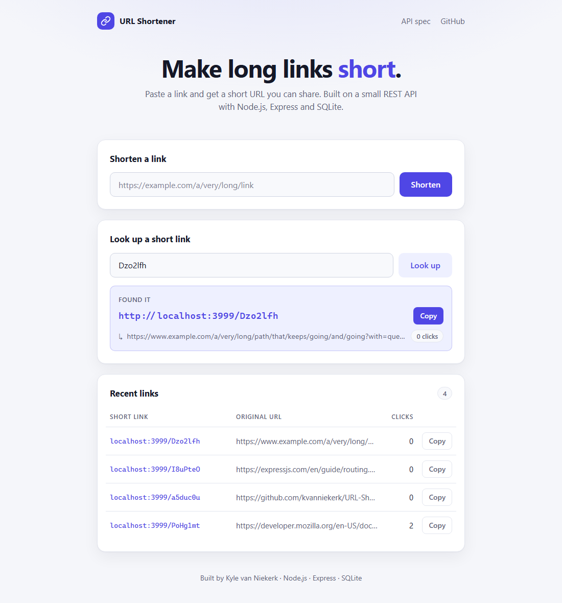

# URL Shortener

[](https://github.com/kvanniekerk/URL-Shortener/actions/workflows/ci.yml)

A URL shortener with a JSON REST API and a web UI, built with **Node.js**, **Express** and **SQLite**.



## Features

- **REST API** to create, look up and list short links ([OpenAPI spec](public/openapi.yaml))
- **Redirects** from `/:code` to the original URL, with a visit counter
- **Persistent storage** in SQLite (`better-sqlite3`)
- **Safe input handling**: only `http`/`https` URLs are accepted (no `javascript:` or `data:` links), with a length limit and consistent JSON errors
- **De-duplication**: shortening the same URL twice returns the existing link
- **Web UI** that works without JavaScript and is upgraded to use the API with `fetch` when JavaScript is available; responsive, with light and dark modes
- **Tests** using Node's built-in test runner and Supertest, run in CI on every push

## Getting started

Requires Node.js 20 or later.

```bash
npm install
npm start          # or: npm run dev  (restarts on file changes)
```

Open <http://localhost:3000>.

### Configuration

Copy `.env.example` to `.env` to override the defaults:

| Variable        | Default           | Description                                                                 |
| --------------- | ----------------- | --------------------------------------------------------------------------- |
| `PORT`          | `3000`            | Port to listen on                                                           |
| `BASE_URL`      | request origin    | Public origin used for short links, e.g. `https://sho.rt`                   |
| `DATABASE_PATH` | `./data/urls.db`  | SQLite database file                                                        |
| `TRUST_PROXY`   | unset             | Set (e.g. `1`) behind a reverse proxy so `X-Forwarded-Proto` is respected   |

### Docker

```bash
docker build -t url-shortener .
docker run -p 3000:3000 -v url-data:/app/data url-shortener
```

## API

All API responses are JSON. Request bodies may be JSON or form-encoded.
The full specification is in [`public/openapi.yaml`](public/openapi.yaml) (also served at `/openapi.yaml`).

| Method | Path               | Description                                   | Success          |
| ------ | ------------------ | --------------------------------------------- | ---------------- |
| `POST` | `/api/urls`        | Create a short link                           | `201` (or `200` if it already exists) |
| `GET`  | `/api/urls`        | List recent links (`?limit=1..100`, default 20) | `200`          |
| `GET`  | `/api/urls/:code`  | Look up a link by its code                    | `200`            |
| `GET`  | `/:code`           | Redirect to the original URL                  | `302`            |

### Create a short link

```bash
curl -i -X POST http://localhost:3000/api/urls \
  -H "Content-Type: application/json" \
  -d '{"url": "https://example.com/some/long/path"}'
```

```http
HTTP/1.1 201 Created
Location: /api/urls/aB3dE9x
Content-Type: application/json; charset=utf-8

{
  "code": "aB3dE9x",
  "shortUrl": "http://localhost:3000/aB3dE9x",
  "originalUrl": "https://example.com/some/long/path",
  "createdAt": "2026-01-01T12:00:00.000Z",
  "visits": 0
}
```

### Look up a short link

```bash
curl http://localhost:3000/api/urls/aB3dE9x
```

Returns the same shape as above.

### Errors

Errors use a consistent shape and an appropriate status code:

```json
{ "error": { "code": "invalid_url", "message": "Please provide a valid http(s) URL (max 2048 characters)." } }
```

| Status | `code`              | When                                         |
| ------ | ------------------- | -------------------------------------------- |
| `400`  | `invalid_body`      | Request body is not valid JSON               |
| `404`  | `not_found`         | Unknown code or API route                    |
| `413`  | `payload_too_large` | Request body larger than 10 KB               |
| `422`  | `invalid_url`       | Missing, malformed, non-http(s) or self-referencing URL |

### Design notes

- **Codes** are 7 characters from `[A-Za-z0-9]`, generated with `crypto.randomInt` (about 3.5 trillion possibilities). Collisions are caught by the database primary key and retried.
- **302, not 301**: browsers cache permanent redirects, which would skip the server and stop visits from being counted.
- **Short link host** comes from `BASE_URL` if set, otherwise from the incoming request, so links work wherever the app is deployed.

## Project structure

```
server.js            Entry point: config, start-up, graceful shutdown
src/app.js           Express app: API routes, UI routes, redirects, error handling
src/store.js         SQLite storage
src/codes.js         Short code generation and validation
src/validate.js      URL validation
views/               EJS templates (page, 404 and shared partials)
public/              Static assets: CSS, client-side JS, favicon, OpenAPI spec
test/                API and UI tests
```

## Tests

```bash
npm test
```

Tests run against the Express app in-process with an in-memory SQLite database, so there's no need to start the server first.

